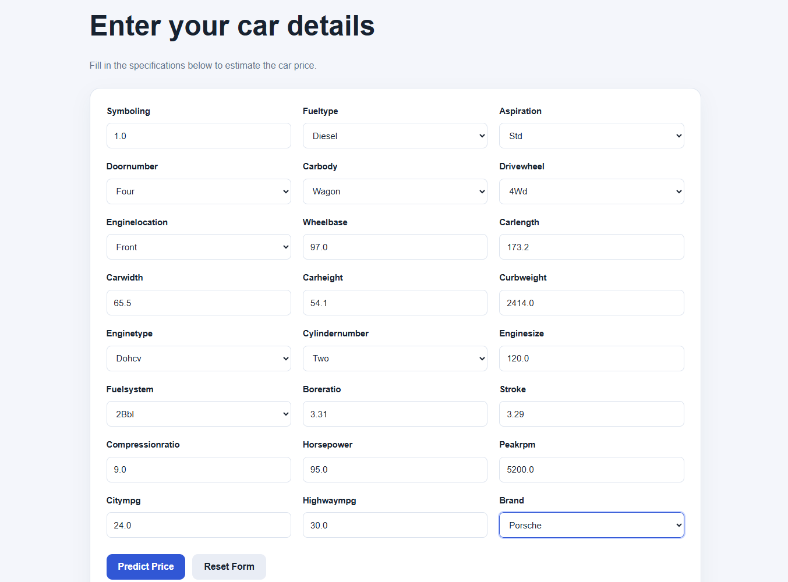

# 🚗 Car Price Prediction

A Machine Learning web application that predicts the price of a car based on its specifications using Python and Flask.

## 📌 Project Overview

This project uses machine learning techniques to estimate car prices based on features such as fuel type, transmission, mileage, engine size, horsepower, and other car specifications.

## ✨ Features

- Predict car prices using a trained machine learning model.
- User-friendly web interface built with Flask.
- Data preprocessing and exploratory data analysis.
- Model evaluation using R², Mean Squared Error (MSE), and Mean Absolute Error (MAE).
- Feature importance visualization.
- Hyperparameter tuning to improve model performance.

## 🛠️ Technologies Used

- Python
- Pandas
- NumPy
- Scikit-learn
- Matplotlib
- Seaborn
- Flask
- HTML, CSS, JavaScript
- Jupyter Notebook

## 📸 Screenshots

### Home Page

### Prediction Result

## 📊 Model Evaluation

The project evaluates its models using:

- R² Score
- Mean Squared Error (MSE)
- Mean Absolute Error (MAE)

The best model is selected based on evaluation results.

